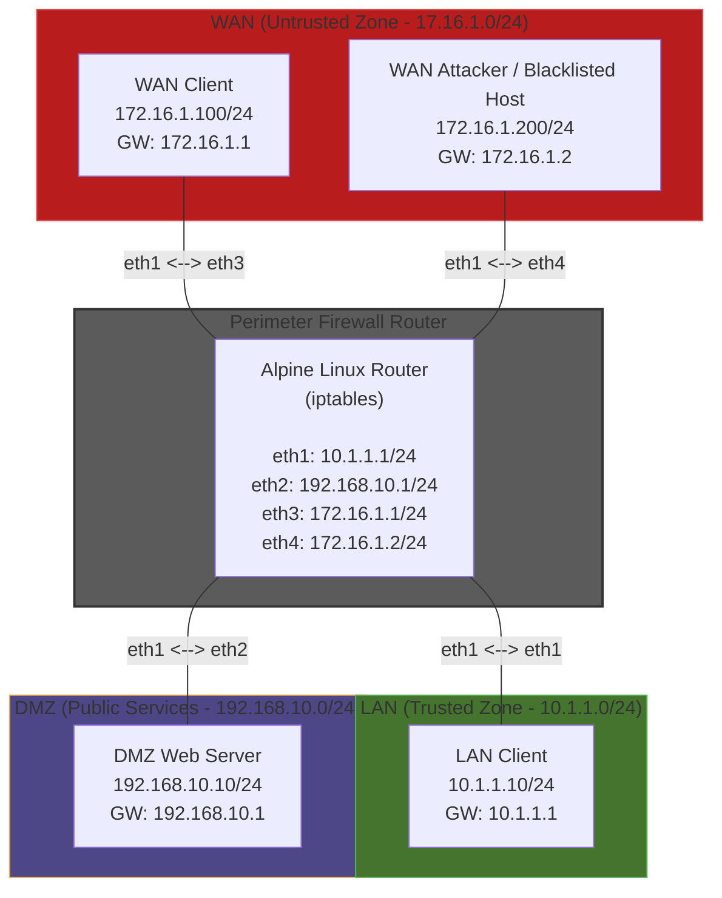

# iptables-firewall-simulation-lab
## Obective:
In this lab, I build and document a three zone perimeter firewall simulation using Containerlab, Alpine Linux, and iptables. It should meet the following specification:

---
## Requirements to Demo this Lab
This lab was created inside Containerlabs and is meant to be run within Linux or WSL. The YAML file and config files are available from the repository.

# Running the Lab
## Deploying the Lab
Open Containerlabs and navigate to the downloaded YAML file, then run the following command:
```
sudo containerlab deploy -t topology.clab.yml
```
## Testing the Firewall
To test connections between networks, where activity from the Attacker should be automatically blocked and HTTP and HTTPS from external WAN clients is all that is allowed, run the following test commands in the WSL terminal to see that the firewall rules are properly set up:
### **Test 1: Web Access from WAN Client to DMZ**

* **Command:** `docker exec -it clab-iptables-firewall-lab-wan-client curl -I http://192.168.10.10`
* **Expected Result:** `HTTP/1.1 200 OK`

### **Test 2: SSH Access from WAN Client to DMZ (Blocked)**

* **Command:** `docker exec -it clab-iptables-firewall-lab-wan-client nc -zv -w 3 192.168.10.10 22`
* **Expected Result:** Connection timeout / failure

### **Test 3: Blacklisted Attacker Access to DMZ (Blocked)**

* **Command:** `docker exec -it clab-iptables-firewall-lab-wan-attacker curl --connect-timeout 3 http://192.168.10.10`
* **Expected Result:** Connection timeout

### **Test 4: Direct Unsolicited WAN Access to Internal LAN (Blocked)**

* **Command:** `docker exec -it clab-iptables-firewall-lab-wan-client ping -c 3 10.1.1.10`
* **Expected Result:** 100% packet loss

### **Test 5: LAN Workstation Access to DMZ**

* **Command:** `docker exec -it clab-iptables-firewall-lab-lan-client curl -I http://192.168.10.10`
* **Expected Result:** `HTTP/1.1 200 OK`

## Destroying the Lab
Once you've finished with the lab, run the following command to destroy and clean-up:
```
sudo containerlab destroy -t topology.clab.yml
```
