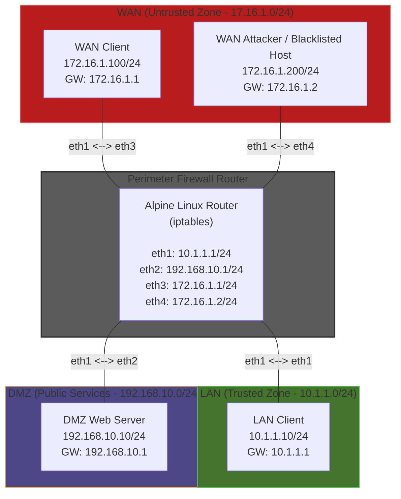

# iptables-firewall-simulation-lab
## Obective:
In this lab, I build and document a three zone perimeter firewall simulation using Containerlab, Alpine Linux, and iptables. It should meet the following specification:

---
